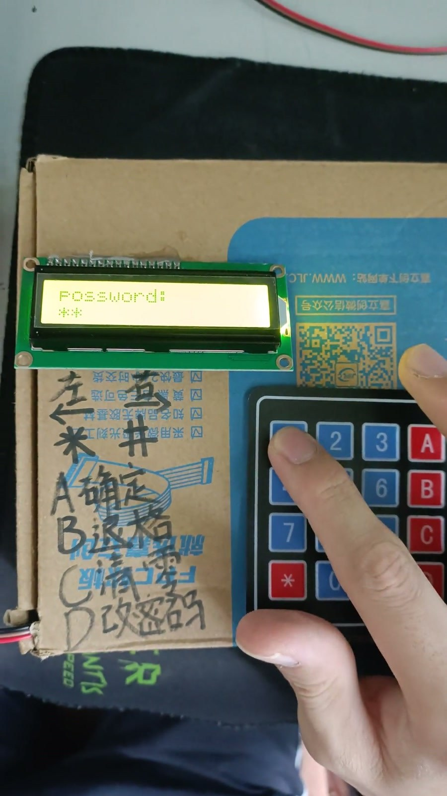
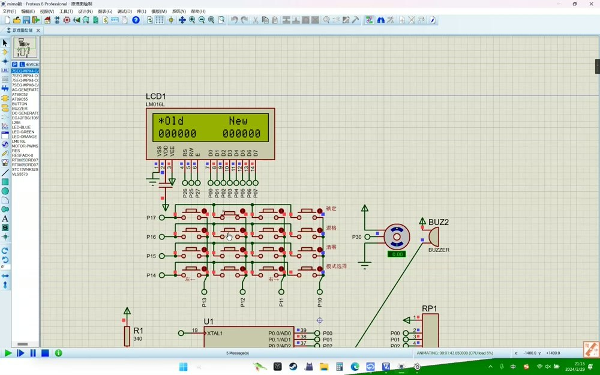

# 智能密码锁

基于 STC15F2K60S2 的电子密码锁，4×4 矩阵键盘输入，LCD1602 显示，密码和开锁记录存在 AT24C02，舵机当锁舌。

暑假花了一周多做的小东西，主要是想练练 51 单片机和裸机状态机。

## 实测

| 项目 | 结果 | 说明 |
|---|---|---|
| 密码长度 | 4~6 位可设 | |
| 记录容量 | 最近 8 条开锁记录 | 每条 4 字节（时间戳 + 结果） |
| 连续错误锁定 | 5 次错误锁 3 分钟 | 锁定时长写 EEPROM，断电不失效 |
| 静态电流 | 90 µA | 掉电模式，万用表串在电池上量 |
| 舵机响应 | 0~180° / 约 480 ms | SG90，50 Hz PWM |
| 按键消抖 | 20 ms | 松手检测 + 延时确认 |

静态电流 90 µA，按 2000 mAh 电池算理论能待机 925 天。但这个数只是算出来的，没真放那么久——实际每次开锁要亮屏、驱动舵机，一天开 10 次的话，粗算能撑三四个月。

## 硬件

| 器件 | 型号 | 说明 |
|---|---|---|
| 主控 | STC15F2K60S2 | 1T 内核，12 MHz |
| 显示 | LCD1602 | 4 位数据线接 P0.4~P0.7 |
| 键盘 | 4×4 矩阵 | P1 口，行 P1.4~P1.7 列 P1.0~P1.3 |
| 存储 | AT24C02 | I2C，SCL=P3.4 SDA=P3.5 |
| 执行 | SG90 舵机 | P2.1，50 Hz PWM |
| 提示 | 有源蜂鸣器 | P2.0 |

## 目录

```
main/       主循环
app/        业务状态机（lock.c）
hardware/   外设驱动
  key.c         矩阵键盘扫描 + 消抖
  lcd1602.c     LCD 4 位模式驱动
  i2c.c         软件模拟 I2C
  at24c02.c     EEPROM 读写 + 数据布局
  servo.c       舵机 PWM（Timer0 软件生成）
  delay.c       微秒/毫秒延时
docs/       原理图、PCB、调试记录
  images/   实物照片、仿真截图
  video/    实物演示、Proteus 仿真
```

## 状态机

```
LOCKED ──输入密码──> 比对
  │                  ├─ 正确 → UNLOCKED ──5 s──> LOCKED
  │                  └─ 错误 → 失败计数 ──≥5──> LOCKOUT ──3 min──> LOCKED
  ├──模式键──> MENU ──选 YES──> CHANGE_OLD ──旧密码正确──> CHANGE_NEW ──> LOCKED
  └──模式键──> MENU ──选 NO ──> LOCKED
```

状态机单独放在 `lock.c` 里，和驱动分开。这样改流程的时候不用碰硬件代码，测试也方便——把 `key_get()` 和 `lcd_puts()` 换成假的就能在 PC 上跑。

## 踩过的坑

### LCD1602 只显示第一行乱码

初始化时 8 位转 4 位模式的顺序错了。正确的顺序是先发 `0x33`（两次复位），再发 `0x32`（切 4 位），中间各留 5 ms。

我一开始直接发 `0x32`，芯片还停在 8 位模式，后面的字节全被当成一条指令的高低位，显示就乱了。

### 按键一次触发多次

矩阵扫描没做松手检测，长按会被识别成连击。

改成 `key_wait()` 里等松开再返回，配合 20 ms 消抖。消抖用延时确认而不是定时器，因为这个系统对实时性没要求，阻塞 20 ms 无所谓。

### 改密码后重启变回旧密码

AT24C02 写完要等 5 ms 内部擦写周期。原来没等就写了下一位，后面的字节被吞。

加 `delay_ms(5)` 解决。这个坑挺隐蔽——调试时看着写入成功了（函数返回正常），但读出来是旧值。

### 舵机抖动

Timer0 中断里直接算角度映射，浮点运算拖长了中断，PWM 节拍不准，舵机就抖。

改成在 `servo_set_angle()` 里算好节拍数存起来，中断里只做比较。中断从 200 多个周期降到 20 个以内。

### 锁定时间重启就失效

失败次数原来只存在 RAM 里，断电重启就清零，等于锁 3 分钟这个功能没用。

改成写进 EEPROM。注意别每次失败都写——AT24C02 擦写寿命 100 万次，频繁写会写坏。现在是失败次数变了才写。

## 编译

Keil C51，Target 选 STC15F2K60S2，晶振 12 MHz。
工程文件在 `project/` 下，或者把 `main/ app/ hardware/` 三个目录的 `.c` 全部加入工程。

## 演示

**实物运行**（39 秒）：开机、输入密码、A 键确认、B 键退格、C 键清零、D 键改密码。

[](docs/video/demo-physical.mp4)

▶ [docs/video/demo-physical.mp4](docs/video/demo-physical.mp4)（11.7 MB，1080p）

**Proteus 仿真**（48 秒）：打板之前先用仿真验证状态机和键盘逻辑，能看到 LCD 显示和按键响应。

[](docs/video/demo-proteus.mp4)

▶ [docs/video/demo-proteus.mp4](docs/video/demo-proteus.mp4)（3.5 MB）

## 实物


实物是模块拼的，装在纸盒里（外壳是包装盒剪的，比较糙）：

- LCD1602（4 位模式，省 4 个 IO）
- 4×4 薄膜矩阵键盘，A/B/C/D 四个功能键
- STC15F2K60S2 最小系统板
- SG90 舵机当锁舌
- AT24C02 存密码和开锁记录

PCB 打样文件在 `docs/Gerber_自制密码锁.zip`，板子 60×40 mm。**打样了但最后没用上**——器件到货晚了，先用模块搭起来跑通功能，PCB 就一直放着。所以视频里看到的是模块，不是那块板子。

打样过程中发现的问题（在模块上验证过）：

1. **舵机电源和 MCU 共地导致偶尔复位**。舵机启动瞬间电流冲到 700 mA，地线上抬，MCU 复位。临时在舵机电源脚并了 100 µF 电容压住了，正式做法应该是电源分开或者加 LC 滤波。
2. **长排线时按键不稳**。键盘上拉用的是 10 kΩ，接 20 cm 排线后分布电容让边沿变缓，偶尔误触发。换成 4.7 kΩ 会好一些，这个没验证。

## 还能加什么

- **刷卡**：加 RC522 模块（SPI 接口），STC15 的 IO 够用。没做是因为手上没模块。
- **指纹**：加 AS608，串口通信。这个更复杂，识别算法都在模块里，单片机只负责发指令。
- **电池电量检测**：现在没有，电池没电了直接不工作。

## 说明

代码量不大，一共两千多行，主要是驱动和状态机。51 单片机的资源很紧（STC15F2K60S2 只有 2 KB RAM），所以很多地方要省着用：LCD 用 4 位模式省 4 个 IO，密码按位分存减少 EEPROM 擦写，中断里不做浮点。

这个项目主要练的是裸机状态机和时序调试，技术深度一般，但每个驱动都是自己写的，出了问题也知道往哪查。
